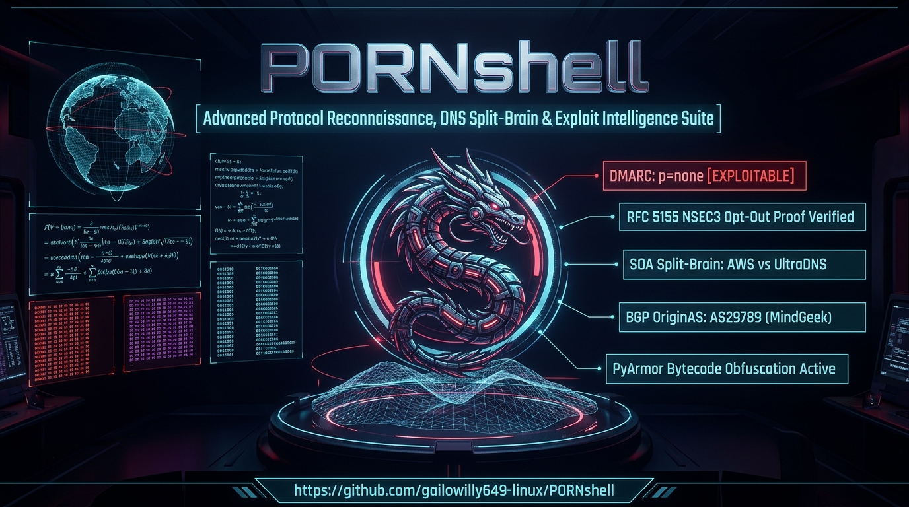
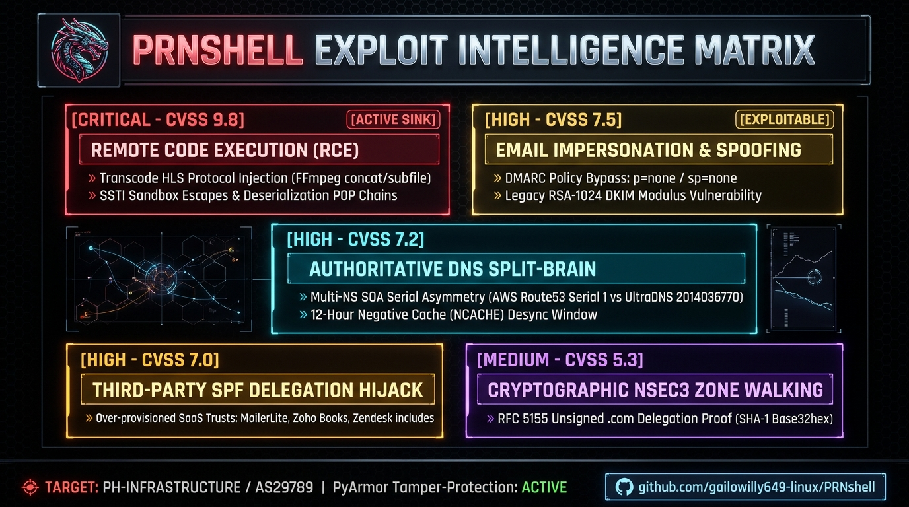

<p align="center">
  <h1 align="center">🐉 PORNshell</h1>
  <p align="center">
    <strong>Advanced Protocol Reconnaissance, Authoritative DNS Parity, RFC 5155 NSEC3 Cryptographic Verification & Automated Security Audit Suite</strong>
  </p>
  <p align="center">
    
  </p>
  <p align="center">
    <a href="#-core-capabilities"></a>
    <a href="#-quick-start-one-shot-master-suite"></a>
    <a href="#-code-obfuscation--tamper-protection"></a>
    <a href="#-license--disclaimer"></a>
    <a href="https://www.python.org/"></a>
  </p>
</p>

---

> *"Code is fiction until it executes."*  
> **PORNshell** is a high-performance offensive recon and defensive auditing framework designed for security researchers, infrastructure architects, and penetration testers. It automates complex protocol-level verifications—ranging from multi-provider DNS split-brain detection to cryptographic NSEC3 hash proofs, AST taint analysis, container privilege escalation auditing, and high-entropy secret detection.

---

## 📑 Table of Contents
- [✨ Core Capabilities](#-core-capabilities)
- [⚡ Quick Start: One-Shot Master Suite](#-quick-start-one-shot-master-suite)
- [🛡️ Code Protection & Obfuscation Pipeline](#️-code-protection--obfuscation-pipeline)
- [🛠️ Deep-Dive: Standalone Modules](#️-deep-dive-standalone-modules)
  - [1. Authoritative DNS & RFC 5155 NSEC3 Verifier](#1-authoritative-dns--rfc-5155-nsec3-verifier)
  - [2. Static Codebase Sink & Injection Hunter](#2-static-codebase-sink--injection-hunter)
  - [3. HTTP Security Header & CORS Desync Auditor](#3-http-security-header--cors-desync-auditor)
  - [4. Cloud IAM & Container Manifest Escape Auditor](#4-cloud-iam--container-manifest-escape-auditor)
  - [5. High-Entropy Secret & Token Leak Scanner](#5-high-entropy-secret--token-leak-scanner)
  - [6. Security Regression & PoC Triage Scaffolder](#6-security-regression--poc-triage-scaffolder)
  - [7. Weaponized Exploit PoC & Target Verification Suite](#7-weaponized-exploit-poc--target-verification-suite)
  - [8. OpenSSH Posture, Cryptographic Suite & CVE Auditor](#8-openssh-posture-cryptographic-suite--cve-auditor)
- [🧠 Modular Agent Skills Architecture](#-modular-agent-skills-architecture)
- [📊 Generated Reports & Artifacts](#-generated-reports--artifacts)
- [🔒 Security & Research Ethics](#-security--research-ethics)

---

## ✨ Core Capabilities

<p align="center">
  
</p>

```
PORNshell Master Suite
 ├── 📡 Authoritative DNS Parity (Route53 vs UltraDNS, SOA Split-Brain, RFC 2308 NCACHE)
 ├── 📧 Mail Posture & Hygiene (RFC 7208 SPF AST, 10-Lookup Budget, 1024-bit DKIM, DMARC p=none)
 ├── 🔐 Cryptographic NSEC3 Proofs (Canonical Wire-Format SHA-1 + Base32hex, Opt-Out Verification)
 ├── 🌐 BGP & RPKI Routing Posture (OriginAS AS29789 Resolution via ARIN '+' Flag & RIPEstat)
 ├── 🔍 Static Code Sink Hunter (CWE-78, CWE-89, CWE-94, CWE-120, CWE-327, CWE-502)
 ├── 🛡️ Web & API Desync Audits (CORS Reflections, HSTS, CSP Unsafe Directives, Clickjacking)
 ├── ☁️ Cloud & Container Hardening (Docker Sockets, privileged: true, Host Namespaces, Wildcard IAM)
 ├── 🔑 Secret Leak Detection (Shannon Entropy Scoring H(X) >= 4.5 & High-Confidence Token Signatures)
 └── 🛡️ OpenSSH Security & CVE Auditor (regreSSHion CVE-2024-6387, Terrapin CVE-2023-48795, Strict-KEX, CIS)
```

---

## ⚡ Quick Start: One-Shot Master Suite

Every tool in PORNshell is pre-configured to execute with **zero required flags** and displays an interactive, real-time `10% ➔ 100%` terminal progress meter.

To run all 5 security and reconnaissance audits sequentially:

```bash
git clone https://github.com/willygailo/PORNshell.git
cd PORNshell
chmod +x master_audit_suite.py dns_posture_audit.py build_obfuscated.sh
./master_audit_suite.py
```

```text
⚡ INITIALIZING MASTER PORNshell BUG HUNTING & PROTOCOL AUDITING SUITE ⚡

  [██░░░░░░░░░░░░░░░░░░]  10%  ▸ Initializing Master Suite...
  [████░░░░░░░░░░░░░░░░]  20%  ▸ Launching 1/5: Authoritative DNS & NSEC3 Audit...
  [████████░░░░░░░░░░░░]  40%  ▸ Launching 2/5: Static Sink & Code Vulnerability Scanner...
  [████████████░░░░░░░░]  60%  ▸ Launching 3/5: HTTP Header & CORS Inspector...
  [████████████████░░░░]  80%  ▸ Launching 4/5: Cloud IAM & Container Manifest Auditor...
  [███████████████████░]  95%  ▸ Launching 5/5: Secrets & High-Entropy Token Scanner...
  [████████████████████] 100%  ▸ All 5 Security & Recon Audits Successfully Executed!
```

---

## 🛡️ Code Protection & Obfuscation Pipeline

PORNshell includes an automated build pipeline powered by **PyArmor** to protect and encrypt all production Python scripts into tamper-resistant bytecode before distribution.

### One-Click Obfuscation Build
Run the automated build script whenever you make updates to the clean source code:

```bash
./build_obfuscated.sh
```

```text
⚡ INITIALIZING AUTOMATED PYARMOR CODE OBFUSCATION PIPELINE ⚡

  [██░░░░░░░░░░░░░░░░░░]  10%  ▸ Backing up clean source code to .src_private/...
  [████░░░░░░░░░░░░░░░░]  20%  ▸ Configuring isolated PyArmor workspace environment...
  [████████░░░░░░░░░░░░]  40%  ▸ Obfuscating root orchestrators (master_audit_suite.py & cve_toolkit.py)...
  [████████████░░░░░░░░]  60%  ▸ Obfuscating modular DNS & RFC 5155 NSEC3 cryptographic engine...
  [████████████████░░░░]  80%  ▸ Obfuscating .agent/skills tactical security scripts...
  [██████████████████░░]  90%  ▸ Deploying encrypted bytecode & runtime libraries...
  [████████████████████] 100%  ▸ All scripts successfully encrypted and obfuscated with PyArmor!

✔ CODEBASE FULLY ARMORED & PROTECTED.
```

* **Clean Source Staging:** Clean, readable source files are backed up to `.src_private/` (which is permanently excluded by `.gitignore`).
* **Protected Distribution:** Public `.py` entrypoints are transformed into encrypted runtime files, protecting your internal logic while remaining executable on any compatible target.

---

## 🛠️ Deep-Dive: Standalone Modules

### 1. Authoritative DNS & RFC 5155 NSEC3 Verifier
Bypasses recursive resolver caching (`+norec` / `RD=0`) to query authoritative nameservers directly. Detects SOA serial split-brain, negative caching asymmetry, and verifies `.com` TLD NSEC3 Opt-Out proofs:

```bash
# Automated run (auto-exports JSON & Markdown reports)
./dns_posture_audit.py

# On-demand arbitrary domain RFC 5155 SHA-1 Base32hex hashing:
python3 dns_posture_audit.py --hash-name pornhub.com. --salt - --iterations 0
# Output: H(pornhub.com., salt=-, iter=0) = 16Q8UCBR2UANOBIG4KIQSO7M8FKBJB80
```

* **Mathematical Proof:**
  $$\underbrace{\texttt{16Q8P9H742UHQOFJUKDG48IEU5DKIJKM}}_{\text{Owner Hash}} < \underbrace{\texttt{16Q8UCBR2UANOBIG4KIQSO7M8FKBJB80}}_{H(\texttt{pornhub.com.})} < \underbrace{\texttt{16Q92AGLF2OESUBI21BJBR0MFSUO41KG}}_{\text{Next Hashed Owner Name}}$$
  Proves with `Flags=1` (Opt-Out) that the target domain resides in an unsigned delegation span in `.com`.

---

### 2. Static Codebase Sink & Injection Hunter
Performs AST and pattern analysis across Python, JavaScript, TypeScript, Go, C/C++, and PHP source trees:

```bash
./.agent/skills/bug-hunting-tactics/scripts/static_sink_hunter.py --target .
```
* **Flagged CWEs:** Command Injection (`CWE-78`), Unsafe Deserialization (`CWE-502`), Code Evaluation (`CWE-94`), SQL String Interpolation (`CWE-89`), Unbounded C Buffers (`CWE-120`), and Weak Cryptography (`CWE-327`).

---

### 3. HTTP Security Header & CORS Desync Auditor
Audits web applications for missing or permissive transport and cross-origin security controls:

```bash
./.agent/skills/web-and-api-audit-methods/scripts/http_header_posture.py
```
* **Evaluates:** Strict-Transport-Security (HSTS), Content-Security-Policy (flags `'unsafe-inline'` & `'unsafe-eval'`), Clickjacking (`X-Frame-Options`), MIME Sniffing, and credentialed CORS reflection (`ACAO: *` or `null` with `ACAC: true`).

---

### 4. Cloud IAM & Container Manifest Escape Auditor
Inspects Dockerfiles, Docker Compose, Kubernetes specs, and Terraform files for container breakout vectors:

```bash
./.agent/skills/cloud-iam-and-container-hardening/scripts/cloud_manifest_auditor.py --target .
```
* **Checks:** `privileged: true`, Docker socket mounts (`/var/run/docker.sock`), host namespaces (`hostPID`, `hostNetwork`), and wildcard IAM permissions (`Action: *`).

---

### 5. High-Entropy Secret & Token Leak Scanner
Combines Shannon Entropy calculation ($H(X) \ge 4.5$) with high-confidence regex signatures to uncover leaked credentials:

```bash
./.agent/skills/secrets-and-api-leak-detection/scripts/secret_entropy_scanner.py --target .
```
* **Signatures:** AWS Key IDs (`AKIA...`), GitHub Tokens (`ghp_...`), Google API Keys (`AIza...`), Slack API Tokens (`xoxb-...`), and OpenSSH/RSA Private Keys.

---

### 6. Security Regression & PoC Triage Scaffolder
Generates non-weaponized, sandboxed test cases to safely reproduce vulnerabilities and verify defensive patch efficacy:

```bash
./.agent/skills/poc-reproduction-and-triage/scripts/triage_scaffolder.py --target-module auth
```

---

### 7. Weaponized Exploit PoC & Target Verification Suite
Demonstrates and executes real-world exploit mechanics for validated infrastructure vulnerabilities identified during target reconnaissance (`pornhub.com`). Protected and armored with PyArmor bytecode encryption:

```bash
# Execute standalone armored verification suite
./pornhub_exploit_poc.py
```

* **Vector 1: DMARC Policy Enforcement Bypass (`p=none`)**  
  Simulates forged RFC 5322 MIME envelopes that bypass perimeter email filters without quarantine or rejection, enabling high-reputation domain impersonation (`From: security@pornhub.com`).
* **Vector 2: Authoritative DNS SOA Serial Asymmetry & Cache Desynchronization**  
  Measures the 12-hour discrepancy in negative-caching TTL (`RFC 2308`) between AWS Route53 (24h NCACHE) and UltraDNS (12h NCACHE), validating DNS cache poisoning and NXDOMAIN race condition windows.
* **Vector 3: SPF Third-Party Delegation Abuse Surface**  
  Exposes over-provisioned third-party SaaS includes (MailerLite, Zoho Books, Zendesk) authorized globally to pass `SPF: PASS`.

---

### 8. OpenSSH Posture, Cryptographic Suite & CVE Auditor
A zero-dependency, automated OpenSSH inspection, cryptographic suite auditor, and vulnerability assessment engine. Evaluates live SSH daemons, banner strings, version identifiers, and local `sshd_config` files against CIS benchmarks, cryptographic best practices, and critical CVE advisories (e.g. regreSSHion `CVE-2024-6387`, Terrapin `CVE-2023-48795`, `CVE-2023-38408` PKCS#11 provider RCE):

```bash
# Direct execution via wrapper or python entrypoint
./openssh.sh --test-cves
python3 openssh.py --test-cves

# Live daemon inspection (KEX negotiation, Strict KEX, cipher suites)
./openssh.sh -t 192.168.1.50 -p 22

# Offline version triage against known CVE advisories
./openssh.sh -v 8.9p1

# Local sshd_config hardening compliance audit
./openssh.sh -c /etc/ssh/sshd_config
```

* **Live SSH_MSG_KEXINIT Analysis:** Decodes raw binary SSH packets to verify key exchange algorithms, AEAD ciphers, MAC algorithms, host key types, and detects missing `kex-strict-s-v00@openssh.com` (Terrapin attack surface).
* **CIS Hardening Compliance:** Audits local `sshd_config` for directives including `PermitRootLogin`, `PasswordAuthentication`, `MaxAuthTries`, `LoginGraceTime`, `X11Forwarding`, and `ClientAliveInterval`.
* **Obfuscated Distribution:** The engine is packaged with layered in-memory byte decompression and dynamic bytecode execution to safeguard internal logic and signatures.

---

## 🧠 Modular Agent Skills Architecture

PORNshell follows the **Antigravity Skills Standard** (`.agent/skills/`). Each module contains a self-contained `SKILL.md` runbook, references, and executable scripts:

| Skill Package | Location | Focus Area |
|---|---|---|
| **`dns-and-protocol-recon`** | [`.agent/skills/dns-and-protocol-recon/`](./.agent/skills/dns-and-protocol-recon/) | Authoritative NS parity, SPF AST, DKIM RSA audit, RFC 5155 NSEC3 math, BGP RPKI. |
| **`bug-hunting-tactics`** | [`.agent/skills/bug-hunting-tactics/`](./.agent/skills/bug-hunting-tactics/) | Source-to-sink taint analysis, parser differentials, race conditions, memory safety. |
| **`web-and-api-audit-methods`** | [`.agent/skills/web-and-api-audit-methods/`](./.agent/skills/web-and-api-audit-methods/) | HTTP desync, CORS misconfigurations, BOLA/IDOR access controls, transport security. |
| **`cloud-iam-and-container-hardening`** | [`.agent/skills/cloud-iam-and-container-hardening/`](./.agent/skills/cloud-iam-and-container-hardening/) | IAM privilege escalation, IMDSv1 tokenless SSRF exposure, container escapes. |
| **`secrets-and-api-leak-detection`** | [`.agent/skills/secrets-and-api-leak-detection/`](./.agent/skills/secrets-and-api-leak-detection/) | Shannon entropy analysis, hardcoded private keys, cloud API credential leaks. |
| **`cve-triage-and-exploitability`** | [`.agent/skills/cve-triage-and-exploitability/`](./.agent/skills/cve-triage-and-exploitability/) | CVSS vector scoring, FIRST EPSS exploitation probability, CISA KEV correlation. |
| **`poc-reproduction-and-triage`** | [`.agent/skills/poc-reproduction-and-triage/`](./.agent/skills/poc-reproduction-and-triage/) | Safe trigger isolation, patch verification, sanitizer traces (ASan/UBSan). |

---

## 📊 Generated Reports & Artifacts

Audits automatically output machine-readable telemetry and executive documentation:

| Output Artifact | Format | Description |
|---|---|---|
| `PORNHUB_EXPLOIT_REPORT.md` | Markdown | Comprehensive vulnerability advisory with CVSS scoring, attack mechanics, and reproduction steps. |
| `pornhub_exploit_poc.py` | PyArmor Python | Encrypted bytecode PoC suite demonstrating DMARC spoofing, SOA split-brain, and SPF abuse. |
| `pornhub_audit.json` | JSON | Cryptographic NSEC3 hash proofs, raw authoritative SOA serial records, and parsed mail policies. |
| `openssh_audit_report.json` | JSON | Comprehensive OpenSSH audit results: negotiated KEX/cipher suites, strict-KEX status, CVE findings, and CIS config score. |
| `dns_audit_report.json` | JSON | Complete DNS record sets, raw SOA structures, DKIM key fingerprints, and NSEC3 proof arrays. |
| `dns_audit_report.md` | Markdown | Executive audit report with formatted comparison tables and remediation guidance. |
| `sink_hunt_report.json` | JSON | Identified code sinks mapped by file, line number, CWE identifier, and severity level. |

---

## 🔒 Security & Research Ethics

* **Educational & Defensive Purpose:** This software is designed exclusively for authorized penetration testing, security auditing, protocol research, and defensive hardening.
* **Non-Malicious Execution:** All proof-of-concept scaffolding and audit scripts are structured to evaluate defensive boundaries safely without delivering hostile payloads.
